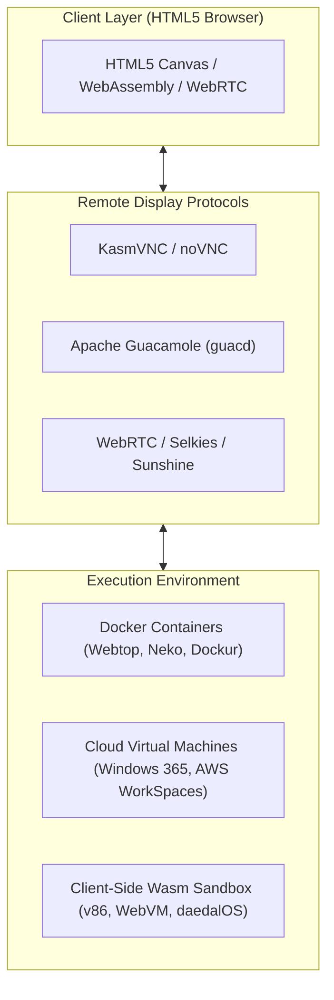

# Awesome-Desktop-Operating-Systems-Web-Desktops

> Curated index of top SaaS Cloud PCs, Desktop-as-a-Service (DaaS) solutions, browser-based Web Desktops, Docker containerized OS environments, and open-source virtual desktop infrastructure.

A comprehensive, SEO-optimized directory tracking enterprise **SaaS / hosted platforms** and **open-source GitHub projects** powering **Desktop Operating Systems & Web Desktops**. These platforms stream, emulate, containerize, and render interactive GUI desktop operating systems directly inside modern web browsers via HTML5, WebRTC, Docker, WebAssembly (Wasm), and VDI streaming protocols.

---

## Table of Contents

- [Sector Overview & Market Dynamics](#sector-overview--market-dynamics)
- [SaaS & Hosted Platforms](#saas--hosted-platforms)
- [Open-Source GitHub Projects](#open-source-github-projects)
- [Architecture & Framework Comparison](#architecture--framework-comparison)
- [How to Contribute](#how-to-contribute)
- [Support & Share](#support--share)
- [Disclaimer](#disclaimer)

---

## Sector Overview & Market Dynamics

The global **Desktop-as-a-Service (DaaS)** and Cloud Workspace market is estimated at **$7.9B – $9.8B in 2025** and projected to expand to **$8.4B – $11.5B by 2026** (growing at an 11%–13% CAGR), fueled by persistent remote/hybrid enterprise workforce adoption and secure browser isolation demands. 

The sector features a **hybrid market structure with high concentration at the foundational enterprise infrastructure layer** (dominated by hyperscalers Microsoft Azure and Amazon AWS, alongside legacy virtualization vendors VMware/Broadcom and Citrix), accompanied by **moderate fragmentation in the edge, containerized, and specialized application-streaming tier** where nimble innovators (e.g., Kasm Technologies, Dizzion, Neverinstall) and open-source browser desktop projects cater to privacy-conscious enterprises, educational labs, and self-hosting homelabs.

---

## SaaS & Hosted Platforms

*Commercial Desktop-as-a-Service (DaaS), hosted virtual desktop infrastructure (VDI), and managed browser workspaces, sorted by company size / revenue / valuation (descending).*

| Platform | Company Size (Valuation / Revenue) | Description | Pricing (Starting Tier) | Free Tier / Free Trial Limits |
| :--- | :--- | :--- | :--- | :--- |
| **[Microsoft Windows 365](https://www.microsoft.com/en-us/windows-365)** | ~$3.1T Market Cap / ~$245B Ann. Rev. | Enterprise Cloud PC streaming persistent personalized Windows 11 desktops to any HTML5 browser, tablet, or thin client with Azure AD. | $28.00 / user / month (Windows 365 Business, 1 vCPU, 2 GB RAM, 64 GB Storage) | 30-day free trial (up to 1 license per tenant, 2 vCPU / 8 GB RAM / 128 GB storage configuration; requires payment method registration). |
| **[Amazon WorkSpaces](https://aws.amazon.com/workspaces/)** | ~$2.1T Market Cap / ~$620B Ann. Rev. | Fully managed, persistent cloud virtual desktop service on AWS supporting Windows, Ubuntu, and Amazon Linux workspaces with Active Directory integration. | $21.00 / user / month (Linux, Value bundle flat rate) or $7.25 / month + $0.22 / hour (hourly metering) | 40 hours/month free for up to 3 billing cycles on AWS Free Tier (limited to 2 standard bundle virtual desktops in AutoStop mode). |
| **[Paperspace Core](https://www.paperspace.com/core)** | ~$2.6B Parent Cap (DigitalOcean acquired for $111M) | Cloud virtual desktop and high-performance GPU workstation infrastructure offering ultra-low-latency browser streaming for CAD, 3D rendering, and AI developers. | $0.0045 / hour (CPU entry instances) or $0.45 / hour (Dedicated GPU instances) + $5.00 / month per 50 GB SSD storage | No free trial on Core virtual desktops (pay-as-you-go hourly compute from minute one); limited free CPU/GPU notebook hours offered on sister service Paperspace Gradient. |
| **[Dizzion Frame](https://www.dizzion.com/frame/)** | ~$20M Ann. Rev. / $14.9M Total Funding | Enterprise cloud-native DaaS platform streaming GPU-accelerated Windows and Linux applications directly to HTML5 browsers without client plugins. | $18.00 / user / month (baseline commitment bundle in cloud marketplace) | 30-day proof-of-concept / evaluation trial via enterprise sales registration or partner hardware bundle; no perpetual self-service free tier. |
| **[Kasm Workspaces Cloud](https://www.kasmweb.com/)** | ~$2.8M Ann. Rev. (Private / Bootstrapped) | Containerized Desktop Infrastructure (CDI) streaming isolated, disposable Linux and Windows environments and secure web isolation sandboxes. | $10.00 / named user / month (Self-Hosted Professional Edition) or $10.00 / month (Cloud Personal plan) | 5 concurrent streaming sessions free forever via the self-hosted Kasm Workspaces Community Edition (includes full Docker app catalog and community support). |
| **[Neverinstall](https://neverinstall.com/)** | ~$1.21M Total Venture Funding (Seed) | Cloud personal computer platform enabling browser-streamed Linux and Windows workspaces with pre-installed developer tools, browsers, and creative software. | $15.00 / user / month (Basic Virtual Desktop plan with dedicated CPU and cloud storage) | No permanent free tier; evaluation trial provided via request-a-demo pilot programs (1–8 weeks pilot window for qualified enterprise teams). |
| **[AppOnFly](https://www.apponfly.com/)** | ~$1.0M Ann. Rev. / ~$1M Funding | Instant cloud Windows VPS and remote desktop streaming platform accessible directly in web browsers or via standard RDP clients within seconds. | $17.50 / month (Windows VPS base plan with 1 vCPU and 2 GB RAM) | 30-minute free trial session (allows instant testing in a web browser tab without registration, non-persistent session storage). |
| **[Shells.com](https://www.shells.com/)** | Private Micro-SaaS (Estimated <$1M Rev.) | Personal cloud desktop service providing pre-configured Ubuntu, Debian, Fedora, and Windows virtual desktops accessible from smartphones and Chromebooks. | $4.95 / month (Shells Lite plan, 1 vCPU, 2 GB RAM, 40 GB Storage, subject to usage caps) or $9.95 / month (Basic unlimited) | 7-day money-back satisfaction guarantee (full refund if cancelled within 7 days; no permanent free-for-ever tier). |
| **[OS.js Cloud / Hosted](https://os-js.org/)** | Independent Open Source / Community Hosted | Managed hosting and cloud SaaS infrastructure deployments built around the open-source modular OS.js web desktop platform for white-label web portals. | $5.00 – $10.00 / month (standard single-tenant VPS hosting via Coolify / Elestio managed app platforms) | 100% free and open-source software license (self-host on any server or free-tier cloud VPS indefinitely with no user or core limitations). |

---

## Open-Source GitHub Projects

*Active open-source web desktops, browser-native operating system simulations, containerized remote desktop suites, and low-latency streaming servers. Sorted by GitHub Star Count (descending).*

| Project & Repo Link | GitHub Stars | Core Architecture | Focus & Highlights |
| :--- | :---: | :--- | :--- |
| **[RustDesk](https://github.com/rustdesk/rustdesk)** |  | Rust / Flutter / WebRTC | Full-featured open-source remote desktop client and server software designed as a self-hosted alternative to TeamViewer and AnyDesk with end-to-end encryption. |
| **[dockur/windows](https://github.com/dockur/windows)** |  | Docker / KVM / QEMU / HTML5 | Automated Windows virtual machines (Windows 11, 10, Server) running inside Docker containers with KVM hardware acceleration and embedded web-browser viewer. |
| **[Puter](https://github.com/HeyPuter/puter)** |  | JavaScript / Node.js / HTML5 | Feature-rich, self-hostable browser desktop environment and personal Cloud OS featuring filesystem abstraction, window management, code editors, and AI app ecosystem. |
| **[Sunshine](https://github.com/SunshineStream/Sunshine)** |  | C++ / NVENC / VAAPI / WebRTC | Self-hosted, low-latency game and desktop streaming server for Moonlight clients supporting 4K HDR, multi-monitor setups, and hardware encoding. |
| **[Nextcloud Server](https://github.com/nextcloud/server)** |  | PHP / JavaScript / Vue | Self-hosted open-source productivity suite and web workspace uniting collaborative office document suites, files, groupware, and multimedia directly in the browser. |
| **[Barrier](https://github.com/debauchee/barrier)** |  | C++ / Socket Networking | Open-source KVM software allowing a single mouse and keyboard to seamlessly control multiple physical desktop operating systems across networks. |
| **[copy/v86](https://github.com/copy/v86)** |  | Rust / WebAssembly / x86 JIT | x86 hardware PC emulator and x86-to-Wasm JIT running entirely client-side inside a browser tab, capable of booting Linux, Windows 98, ReactOS, and FreeDOS. |
| **[Neko](https://github.com/m1k1o/neko)** |  | Go / WebRTC / Docker | Self-hosted virtual browser and desktop container streaming interactive environments with ultra-low latency for multiplayer co-browsing and watch parties. |
| **[dockur/macos](https://github.com/dockur/macos)** |  | Docker / KVM / OSX-KVM | macOS virtual machine running inside a Docker container with automated ISO download, KVM acceleration, and built-in web-based desktop console access. |
| **[Moonlight Qt](https://github.com/moonlight-stream/moonlight-qt)** |  | C++ / Qt / GameStream | Cross-platform client for Sunshine and NVIDIA GameStream delivering silky smooth 120 FPS desktop streaming across Windows, macOS, Linux, and Steam Link. |
| **[WebVM](https://github.com/leaningtech/webvm)** |  | C++ / WebAssembly / CheerpX | Serverless Linux x86 virtualization environment running client-side inside HTML5/Wasm with full terminal, package manager, and Tailscale mesh networking. |
| **[noVNC](https://github.com/novnc/noVNC)** |  | JavaScript / HTML5 Canvas / WebSocket | Foundational open-source HTML5 VNC client library powering clientless browser console access across Proxmox VE, OpenStack, QEMU/KVM, and Kubernetes pods. |
| **[daedalOS](https://github.com/DustinBrett/daedalOS)** |  | TypeScript / React / Next.js | High-fidelity desktop operating system simulation in the browser equipped with file managers, DOSBox emulation, Winamp, video players, and code editors. |
| **[Win11React](https://github.com/blueedgetechno/win11React)** |  | React / SCSS / JavaScript | Modern browser recreation of the Windows 11 desktop experience featuring Start Menu, Edge browser, Terminal, widgets, and themes built with pure web technologies. |
| **[Input Leap](https://github.com/input-leap/input-leap)** |  | C++ / OpenSSL | Active, modern fork of Barrier and Synergy delivering cross-platform virtual KVM keyboard and mouse sharing with clipboard synchronization and TLS encryption. |
| **[OS.js](https://github.com/os-js/OS.js)** |  | JavaScript / Web Components / Node.js | Modular, extensible web desktop platform providing full window managers, virtual filesystem adapters (WebDAV, Google Drive, S3), and an application SDK. |
| **[KasmVNC](https://github.com/kasmtech/KasmVNC)** |  | C / C++ / WebP / WebRTC | Modern, high-performance VNC server engineered specifically for web browser streaming with WebP/QOI encoding, clipboard sync, and audio pass-through. |
| **[LinuxServer Webtop](https://github.com/linuxserver/docker-webtop)** |  | Docker / Alpine / Ubuntu / Arch | Ready-to-run containerized Linux desktop environments (XFCE, KDE Plasma, MATE, i3, Openbox) streamed directly into web browsers via KasmVNC and Selkies. |
| **[Apache Guacamole Server](https://github.com/apache/guacamole-server)** |  | C / guacd / RDP / VNC / SSH | Native server daemon (`guacd`) translating RDP, VNC, and SSH protocols into Guacamole protocol streams for browser-native remote desktop delivery. |
| **[Xpra](https://github.com/Xpra-org/xpra)** |  | Python / C / Cython / HTML5 | "Screen for X" multi-platform remote display server allowing individual GUI applications or full desktop sessions to stream seamlessly across networks and HTML5. |
| **[Selkies](https://github.com/selkies-project/selkies)** |  | Python / WebRTC / GStreamer | Ultra-low-latency GPU-accelerated (NVENC/VAAPI) WebRTC desktop streaming platform designed for containerized Linux environments in Kubernetes and HPC. |
| **[Apache Guacamole Client](https://github.com/apache/guacamole-client)** |  | Java / TypeScript / HTML5 | Clientless web application and JavaScript API library connecting to `guacd` to stream RDP, VNC, and SSH sessions to browsers without plugins. |

---

## Architecture & Framework Comparison

Understanding how modern browser desktops function:

1. **Client-Side Web Desktops & OS Emulators** (*Puter, daedalOS, WebVM, copy/v86, Win11React*):
   - Execute directly in the client browser engine via WebAssembly, Web Workers, and local virtual filesystems.
   - Zero cloud compute cost; optimal for privacy, lightweight productivity, and offline sandboxes.
2. **Containerized Linux Desktops (CDI)** (*LinuxServer.io Webtop, Kasm Workspaces, Neko*):
   - Isolate each desktop instance inside a lightweight OCI/Docker container.
   - Deliver sub-second startup times, elastic scale, and rapid ephemeral teardown.
3. **HTML5 Clientless Remote Desktop Gateways** (*Apache Guacamole, KasmVNC, noVNC, Xpra*):
   - Bridge legacy enterprise protocols (RDP, VNC, SSH) into native WebSocket and WebRTC streams without requiring client agents.
4. **Cloud Desktop-as-a-Service (DaaS)** (*Windows 365, Amazon WorkSpaces, Paperspace Core, Dizzion Frame*):
   - Fully managed enterprise infrastructure providing dedicated cloud compute, Active Directory integration, persistent enterprise backup, and GPU acceleration.

---

## How to Contribute

We welcome contributions from developers, homelab enthusiasts, and enterprise cloud architects!

1. **Fork this repository** to your GitHub profile.
2. **Add or update an entry** in `README.md` keeping the established tabular format:
   - For **SaaS**: Include platform name, company valuation/revenue tier, specific starting price, and exact free tier/trial limits.
   - For **Open-Source**: Provide repository link, GitHub star badge linking to `/stargazers`, core architecture stack, and concise factual summary.
3. **Ensure proper sorting**:
   - SaaS entries sorted by company size / revenue (descending).
   - Open-source projects sorted by GitHub star count (descending).
4. **Submit a Pull Request** with a brief summary of the changes.

---

## Support & Share

If you find this curated desktop ecosystem index useful:

- ⭐ **Star this repository** to improve visibility for the cloud and self-hosting community.
- 🍴 **Fork & Share** it with your engineering team, homelab circles, and remote work groups.
- ☕ **Sponsor the Maintainer** on [GitHub Sponsors](https://github.com/sponsors/ishandutta2007) to support continuous open-source curation and benchmarking!

---

## Disclaimer

- This repository is a community-curated technical directory for informational purposes and does not constitute commercial endorsement.
- All trademarks, logos, and service marks are the property of their respective owners.
- Exposing remote desktop endpoints (`Webtop`, `Guacamole`, `Puter`, `dockur/windows`) to public networks poses security risks: always enforce TLS/HTTPS reverse proxies, multi-factor authentication (OIDC/MFA), and zero-trust network boundaries.
